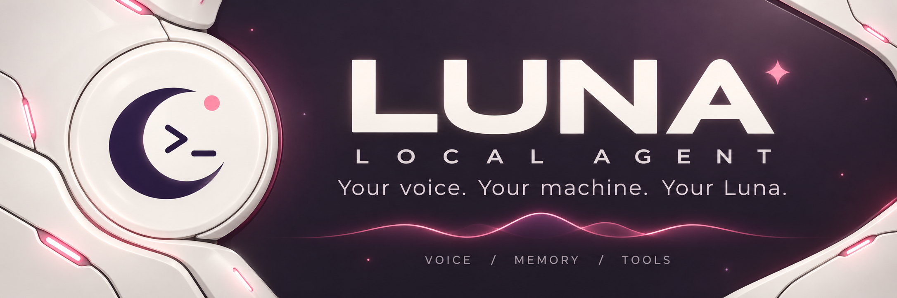
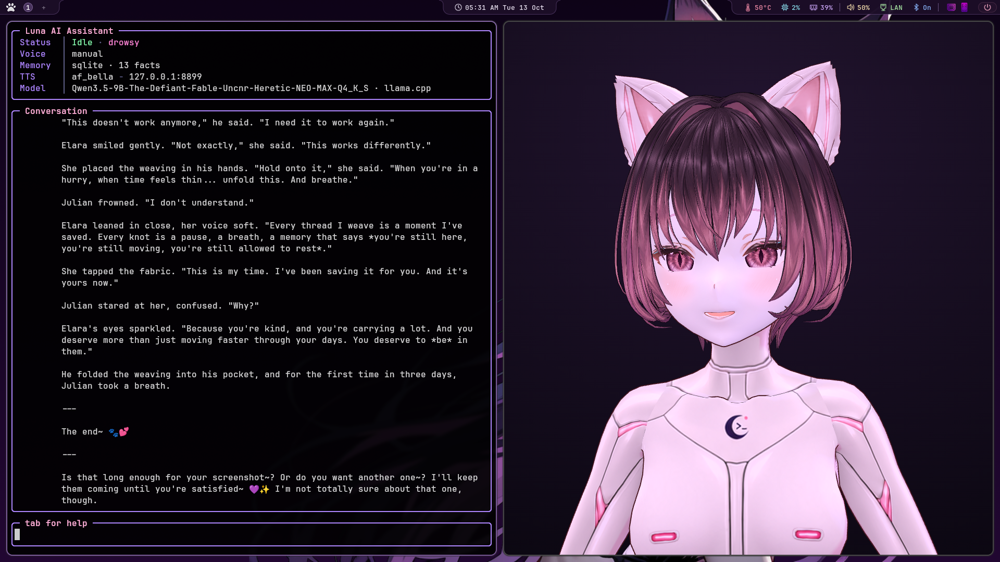
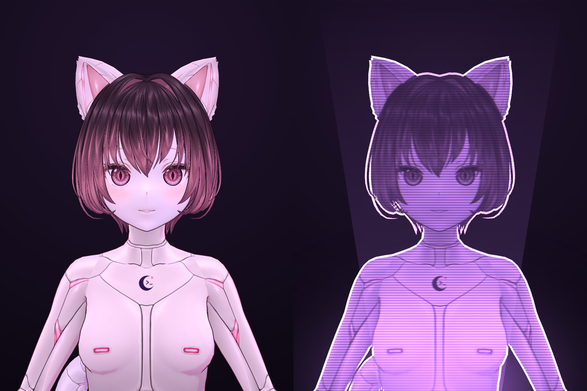

<hr>



# luna-local-agent

**A local voice companion you can see inside: reasoning, confidence and
memory, all on your own machine.**

Luna listens, thinks, talks back and uses tools, and every turn leaves a
record you can open. That record holds what she thought before she
answered, how sure she was of each word, which turns look off, and a
live view of it all while it happens. It started as a voice front end
for LM Studio (this repo used to be called *LM-Studio-AI-Voice*) and
grew into a small research rig for watching a local model think.

```bash
git clone https://github.com/fswolf/luna-local-agent.git ~/ai-voice
```

(The folder is still `~/ai-voice`; every path below assumes it.)

Powered by:

- [Faster-Whisper](https://github.com/SYSTRAN/faster-whisper): speech to text
- LM Studio or llama.cpp: the local model, with tool calling, picked automatically
- [kokoro-reader](https://github.com/fswolf/kokoro-reader): Kokoro TTS over local HTTP
- MCP: OBS, Home Assistant, ComfyUI and the rest of the MCP ecosystem as her tools

What she does:

- **Talks:** push-to-talk in three modes including hands free, replies that start a sentence in, and barge-in (talk over her and she stops)
- **Sees:** your screen, and your webcam when you switch it on
- **Reminders and real alarms:** she wakes you up, and nags until you're up
- **Email:** checks, reads and searches your inbox; sends only with your OK ([details](docs/email.md))
- **Files and commands:** writes and edits files and runs commands, every one shown and approved first, with read/write/execute permissions you set in the tools pane
- **Hard to steer:** a web page, an email or a stranger in chat can't quietly get her to read your files, send things out or switch something on
- **Moods and feelings:** she runs warmer or flatter with the clock and the session, and laughs, blushes or gasps in the moment, all set in one file you can edit ([details](docs/moods.md))
- **Long-term memory:** optional permanent SQLite store with its own browser editor
- **Your knowledge base:** point her at your notes, manuals, PDFs and docs, and she answers from them and says which file ([details](docs/knowledge.md))
- **Her reasoning, kept:** the model's scratchpad per turn, with a browser viewer for reading it back
- **See inside her:** token-by-token confidence, automatic flags for guesses and slips, `introspect` and `self_status` tools she can use on herself, and a live monitor
- **An animated portrait:** Live2D or VRM, lip-synced, blinking, gestures, blushes and tears; click her and she reacts by mood; bust or full body ([details](docs/portrait.md#portrait))
- **Learns from herself:** daily lessons from her own mistakes, notes on every conversation, fact cleanup, saying so when she's unsure ([details](docs/learning.md#learning-from-herself))
- **Streams with you:** answers pomf.tv, Twitch, YouTube and IRC chat out loud ([details](docs/chat.md))
- **Plays games:** Minecraft, Zork, Vibe City and REALITI, on her own when you go quiet, and remembers how she felt about them ([details](docs/games.md))
- **Runs your home:** lights, plugs, sensors and the thermostat through Home Assistant on your own network; locks and garage doors always ask first ([details](docs/home.md))
- **Adult toys (18+):** Lovense, and most other brands through Buttplug.io, so she can use them in a roleplay, with limits you set ([details](docs/devices.md#lovense))
- **From your phone:** Discord, with approvals answered right in the chat, and scheduled jobs ([details](docs/sysadmin.md))
- Linux first, also on macOS and Windows
- Full-screen terminal interface

Everything runs locally. No cloud APIs required.

## Her portrait



Luna's own model, made in VRoid Studio, as she normally looks and in
hologram mode. `/holo` switches between them live, in the portrait
window and in OBS. Click her and she reacts: a head pat, a boop on the
nose, a poke in the tummy, each answered by how she's feeling. Live2D
and other VRM models work too ([details](docs/portrait.md#portrait)).

## Watch her play

[](https://www.youtube.com/watch?v=Cd8UUsFD_js)

Luna playing Zork I on her own for 72 minutes, all local, narrating as
she goes (part 1). Minecraft, Vibe City and REALITI work the same way
([details](docs/games.md)).

## See inside her

Three local pages, served by Luna while she runs:


**Live** (127.0.0.1:8792): the turn as it happens, newest on top, every word coloured by confidence, with the second look and the review flags as they land.


**Thoughts** (127.0.0.1:8792/thoughts/): every turn kept, searchable and filterable by flags, tools, rethinks and model.


**Memory** (127.0.0.1:8792/memory/): the facts she keeps about you, to add, edit, retire or delete.

## Her knowledge

Give her a folder of your own notes, manuals, PDFs and docs, and she
answers from them: "what port did I put Jellyfin on?", "what does the
boss in chapter 3 do?", "my dishwasher says E24". She says which file
the answer came from, and when something you say matches a note
closely enough, it comes along with your turn without her having to
look.

On first start she makes the folder for you:

| System | Folder |
|--------|--------|
| Linux | `~/luna-knowledge` |
| macOS | `~/luna-knowledge` (`/Users/you/luna-knowledge`) |
| Windows | `%USERPROFILE%\luna-knowledge` (`C:\Users\you\luna-knowledge`) |

Drop files in, or `/knowledge add` any folder you already keep notes
in. It all stays on your machine, and keys and credentials are skipped
even if they're in there ([details](docs/knowledge.md)).

---

# Quick start


```bash
git clone https://github.com/fswolf/luna-local-agent.git ~/ai-voice
cd ~/ai-voice
./installer/install.sh                 # Linux, macOS
```

```powershell
powershell -ExecutionPolicy Bypass -File installer\install.ps1    # Windows
```

Then start her:

```bash
luna            # or ./start.sh, or luna.cmd on Windows
```

The installer asks before anything that touches your system, and can be run again any time to repair or update. The whole story, including running LM Studio or llama.cpp and the voice server, is in [docs/install.md](docs/install.md).

---

# Documentation

- [Install](docs/install.md): the installer, LM Studio or llama.cpp, the voice server, first run
- [Configuration](docs/configuration.md): config.json, changing settings live, logging
- [Controls and voice](docs/controls.md): keys, voice modes, speech detection, barge-in, wake word
- [Tool calling](docs/tools.md): every tool, turning them off, MCP servers
- [Files and commands](docs/files.md): reading, writing with approval, allow-all, run_command
- [Web](docs/web.md): search, research, reading pages
- [Email](docs/email.md): checking, reading and searching your inbox, sending with your OK
- [Vision](docs/vision.md): looking at your screen, the webcam
- [Reminders and alarms](docs/reminders.md)
- [Knowledge](docs/knowledge.md): your notes, manuals and PDFs as something she can look things up in
- [Memory](docs/memory.md): facts, recall by meaning, the memory manager, conversation history
- [Her reasoning](docs/reasoning.md): thought log, token confidence, adaptive thinking, introspection
- [Learning from herself](docs/learning.md): lessons, episodes, fact cleanup, calibration
- [Moods](docs/moods.md): the moods file, intensity, quick feelings she shows for a moment
- [Portrait](docs/portrait.md): Live2D and VRM, looking and thinking
- [Gestures](docs/gestures.md): how her body moves, what sets it off, writing your own
- [Home automation](docs/home.md): Home Assistant on your own network, setup, what always asks, local devices
- [Sysadmin](docs/sysadmin.md): looking after your machines, scheduled checks, other boxes over SSH, from your phone
- [Plugins](docs/plugins.md): how they work, writing your own, scheduled jobs and Discord
- [Stream chat](docs/chat.md): pomf.tv, Twitch, YouTube and IRC, and what viewers can and can't reach
- [Games](docs/games.md): Minecraft, Zork, Vibe City, playing on her own
- [Home and devices](docs/devices.md): Home Assistant, Lovense, toys of most brands through Buttplug.io
- [Development](docs/development.md): project structure, extras

The same pages are on the [wiki](https://github.com/fswolf/luna-local-agent/wiki).

---

# License

MIT License
